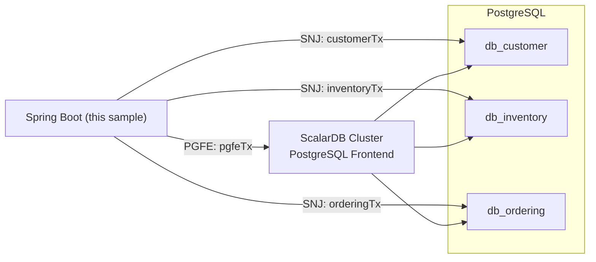

# demo-snj-pgfe-samples

A Spring Boot sample that uses two ways to run ScalarDB transactions from SQL, each where it fits:

- **A transaction in one database → ScalarDB Native JDBC (SNJ).** It runs as a local transaction of
  that database, with the database's own SQL. The tables are ScalarDB tables. The SNJ driver keeps
  its transactions consistent with ScalarDB's transactions on the same rows.
- **A transaction across databases → the PostgreSQL Frontend (PGFE) of ScalarDB Cluster.** It runs
  as one ScalarDB transaction (Consensus Commit) over all the databases, with PostgreSQL's SQL.

The data is split over three PostgreSQL databases, one per namespace:

| Database | Tables |
|---|---|
| `db_customer` | `customer.customers` |
| `db_inventory` | `inventory.items` |
| `db_ordering` | `ordering.orders`, `ordering.statements` (and ScalarDB's coordinator table) |

| Operation | Databases | Runs through | Transaction |
|---|---|---|---|
| CRUD of each table (`/customer-customers`, `/inventory-items`, `/ordering-orders`, `/ordering-statements`) | one | SNJ, that database's DataSource | `customerTx`, `inventoryTx`, `orderingTx` |
| Add stock, for a delivery (`POST /inventory-items/{id}/add-stock?qty=`) | `db_inventory` | SNJ | `inventoryTx` |
| Place an order (`POST /orders`): reduce stock, charge the customer, write the order and its lines | all three | PGFE | `pgfeTx` |
| Cancel an order (`POST /orders/{id}/cancel`), read orders (`GET /orders/{id}`, `GET /customers/{id}/orders`) | all three | PGFE | `pgfeTx` |

Both kinds of transaction write the same rows. For example, adding stock (SNJ) and placing an order
(PGFE) can update the same item at the same time, and neither update is lost
([Try it on one machine](#try-it-on-one-machine) checks this).



## How the code shows the choice

- `config/DataSourceConfig.java` makes four DataSources: three for SNJ
  (`jdbc:scalardb-native:postgresql://…`, one per database) and one for PGFE
  (`jdbc:postgresql://<cluster>:5439/…`). Each DataSource gets a `TransactionRunner`:
  `customerTx`, `inventoryTx`, `orderingTx` and `pgfeTx`. Each DataSource also gets its own instances
  of the repositories (`customersSnj` … and `customersPgfe` …).
- A service picks its runner and repositories with `@Qualifier`:
  - `InventoryItemsService` uses `inventoryTx` and `itemsSnj`.
  - `OrderService` uses `pgfeTx` and the `*Pgfe` repositories.
- The repositories and their SQL are the same for both. Through SNJ, the SQL goes to PostgreSQL
  unchanged. Through PGFE, ScalarDB runs it.
- `TransactionRunner` retries a transaction that failed with a conflict (SQLSTATE 40001), a deadlock
  or a lock timeout (`retry.*` in `application.properties`).
  - PGFE often reports ScalarDB's conflicts at `COMMIT`. A refused commit is rolled back, so it is
    retried too.
  - Any other failure of the commit is reported as 9200 (the outcome is unknown) and is not retried.
    This includes SQLSTATE 40003.
- Everything runs in READ COMMITTED: the sample's connections and ScalarDB's transactions in the
  Cluster. SNJ requires the same isolation level on both sides.

## What you need

- JDK 25 (the Gradle toolchain), `psql`, `curl`, `unzip` and `jq`
- Three PostgreSQL databases, `db_customer`, `db_inventory` and `db_ordering`:
  - each created with collation C (the PostgreSQL Frontend requires it);
  - owned by one user;
  - on one server or on three.
- **ScalarDB Cluster** 3.20 with the PostgreSQL Frontend on (`scalar.db.postgres.enabled=true`) and
  its license. Setting up the Cluster is not part of this sample. You add the three databases to it in
  step 3.

To try everything on one machine with docker, see [Try it on one machine](#try-it-on-one-machine).

## 1. Create the databases

On each PostgreSQL server, as a superuser:

```sql
CREATE DATABASE db_customer  OWNER <user> LC_COLLATE 'C' LC_CTYPE 'C' TEMPLATE template0;
CREATE DATABASE db_inventory OWNER <user> LC_COLLATE 'C' LC_CTYPE 'C' TEMPLATE template0;
CREATE DATABASE db_ordering  OWNER <user> LC_COLLATE 'C' LC_CTYPE 'C' TEMPLATE template0;
```

## 2. Make the tables and set them up

```sh
cp setup/db.env.example setup/db.env && chmod 600 setup/db.env   # then fill in hosts, ports, user, password
setup/setup-db.sh
```

`setup-db.sh` runs three steps:

1. Creates the tables: `schema/<db>.sql` in each database, with plain PostgreSQL DDL.
2. Imports them into ScalarDB with the Schema Loader, and creates the coordinator table in
   `db_ordering`. The Schema Loader uses the same storages and namespace mapping as the Cluster
   (step 3). Each database then holds a `scalardb.metadata` with its own tables.
3. Runs SNJ's setup and check in each database. The setup adds an in-flight index and a read view per
   table.

It ends with `setup-db OK`. The Schema Loader and `scalardb-native-tools` 3.20.0 are downloaded into
`.tools/` the first time.

After this, write to these tables only through SNJ or ScalarDB. Plain `psql` would bypass both, so
use it only to read.

## 3. Add the databases to ScalarDB Cluster, and restart it

The Cluster has to know the three databases as storages of ScalarDB's multi-storage, with each
namespace mapped to its database. Add the lines of
[`cluster/multi-storage.properties.example`](cluster/multi-storage.properties.example) to the Cluster
node's properties. With Helm, these go in `scalardbCluster.scalardbClusterNodeProperties` in the
custom values. Then restart the Cluster (with Helm, `helm upgrade` with the changed values). A
running Cluster does not pick up new storages.

- **If the Cluster already uses multi-storage:**
  - add `customer,inventory,ordering` to its `scalar.db.multi_storage.storages`;
  - add the three mappings to its `namespace_mapping`;
  - keep its own `default_storage` and its coordinator.
- **If the Cluster uses one storage:**
  - switch it to multi-storage;
  - keep the existing database as one of the storages;
  - map its namespaces and the coordinator to it.
- **What the example also sets:**
  - `jdbc.isolation_level=REPEATABLE_READ` for the three storages (SNJ requires it).
  - Cross-partition scans with filtering and ordering, for the three storages (the sample reads orders
    by customer).
  - `scalar.db.consensus_commit.isolation_level=READ_COMMITTED`. This setting applies to the whole
    Cluster.

## 4. Run the sample

```sh
cp src/main/resources/application-local.properties.example src/main/resources/application-local.properties
chmod 600 src/main/resources/application-local.properties   # then fill in the four URLs, users and passwords
./gradlew bootRun
```

At start-up, the sample connects through each DataSource and logs what each one reached. The API
listens on port 8080; Swagger UI is at `http://localhost:8080/swagger-ui.html`.

```sh
B=http://localhost:8080
# one database (SNJ)
curl -s -X POST $B/customer-customers -H 'Content-Type: application/json' \
  -d '{"customer_id":1,"name":"alice","credit_limit":100000,"credit_total":0}'
curl -s -X POST $B/inventory-items -H 'Content-Type: application/json' \
  -d '{"item_id":1,"name":"pen","price":100,"stock":10}'
curl -s -X POST "$B/inventory-items/1/add-stock?qty=5"
# across the databases (PGFE)
curl -s -X POST $B/orders -H 'Content-Type: application/json' \
  -d '{"customer_id":1,"items":[{"item_id":1,"qty":3}]}'
curl -s $B/customers/1/orders
curl -s -X POST $B/orders/<order_id>/cancel
```

`local/try.sh [base-url]` runs a set of these calls and checks the results. It then sends add-stock
and orders for the same item at the same time and checks that the stock and the credit add up. It
ends with `try OK`.

Errors use the same codes as the other samples:

| Code | Meaning | HTTP status |
|---|---|---|
| 9100 | condition not met | 400 |
| 9200 | commit outcome unknown | 500 |
| 9300 | database or transaction failure, after the retries | 500 |
| 9400 | bad request | 400 |
| 9700 | not found | 404 |
| 9800 | credit limit exceeded | 409 |
| 9801 | out of stock | 409 |
| 9802 | order not cancellable | 409 |

## Try it on one machine

`local/local.sh` runs steps 1 to 3 against docker containers on one machine:

- three PostgreSQL 16 containers;
- one ScalarDB Cluster node in standalone mode, with the PostgreSQL Frontend.

It also writes `application-local.properties` for them. You need docker and a ScalarDB Cluster
license:

```sh
export CLUSTER_LICENSE_KEY='<license key>'
export LICENSE_CHECK_CERT_PEM='<license check certificate>'
local/local.sh up                 # containers snjpgfe-*, PostgreSQL Frontend on localhost:15439
./gradlew bootRun                 # in another terminal
local/try.sh                      # ends with "try OK"
local/local.sh down               # removes the containers
```

`local/local.sh` makes the database password at random and keeps it in `local/.local.env`
(mode 600, not in git). It passes the license to the container as environment variables and does not
write it to any file.

## Notes

- When the same row is updated from both sides at once, the PGFE transactions are usually the ones
  that are retried. SNJ takes the database's row lock and waits. PGFE (Consensus Commit) checks for
  conflicts when it commits, and the one that loses is retried. When an SNJ statement meets a row
  that a ScalarDB transaction is writing, it fails with "a row the statement locks is being written by
  a ScalarDB transaction; roll the transaction back and retry it", and `TransactionRunner` retries it.
  With many requests on one row, some fail after `retry.max-attempts` (3).
- Tables that ScalarDB does not manage can also sit in these databases. SNJ passes statements on them
  through unchanged, inside the same local transaction. The sample does not use any.
- Adding a table to ScalarDB later while applications run:
  1. run `SNJ_NO_WAIT=0 setup/setup-db.sh`, so that SNJ's setup waits before it returns;
  2. let ScalarDB transactions write the new table only after the time the setup prints (60 s later).

  See SNJ's documentation, "Adding a table to ScalarDB while applications run".
- Tested with ScalarDB Cluster 3.20.1 (standalone, in docker), ScalarDB Native JDBC 3.20.0, the
  Schema Loader 3.20.0 and PostgreSQL 16.
